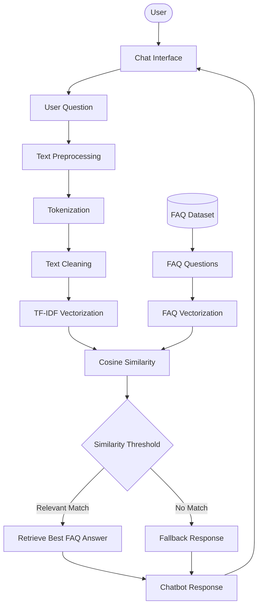
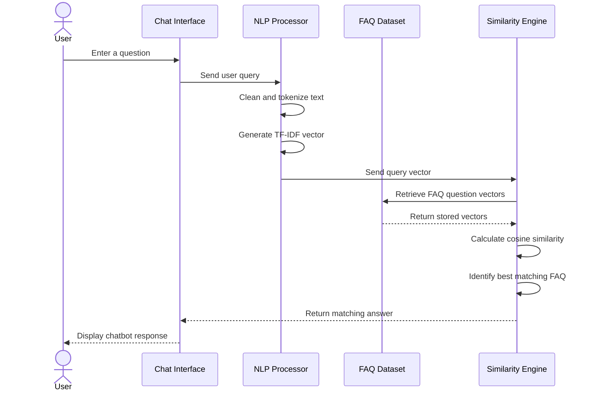

# 🤖 FAQ Chatbot – NLP-Based Question Answering System

An intelligent **FAQ Chatbot** that automatically answers user queries by identifying the most relevant questions from a predefined collection of Frequently Asked Questions (FAQs).

The system uses Natural Language Processing (NLP) techniques to preprocess text and identify similarities between user queries and existing FAQ questions. By applying **TF-IDF Vectorization and Cosine Similarity**, the chatbot retrieves the most relevant answer and presents it through an interactive conversational interface.

The project demonstrates how NLP and text similarity techniques can be used to build a lightweight question-answering system without requiring a large language model.

---

## 📌 Project Overview

The FAQ Chatbot is designed to automate responses to frequently asked questions related to a particular topic, service, or product.

Instead of manually searching through documentation or FAQ pages, users can simply enter their questions in a chatbot interface. The system analyzes the query, compares it against the existing FAQ dataset, and returns the answer associated with the closest matching question.

### 🎯 Objectives

- Develop an interactive chatbot for automated FAQ responses.
- Collect and organize question-answer pairs into a structured dataset.
- Apply NLP techniques to preprocess user queries.
- Convert text into numerical representations using TF-IDF.
- Calculate similarity using Cosine Similarity.
- Retrieve the most relevant FAQ answer.
- Display responses through a conversational interface.

---

## ✨ Key Features

| Feature | Description |
|---|---|
| 💬 Interactive Chat Interface | Allows users to communicate with the chatbot. |
| 📚 FAQ Knowledge Base | Stores predefined questions and answers. |
| 🧠 NLP Preprocessing | Cleans and normalizes text before matching. |
| 🔤 Text Tokenization | Breaks sentences into meaningful tokens. |
| 📊 TF-IDF Vectorization | Converts textual data into numerical vectors. |
| 🎯 Cosine Similarity | Measures similarity between user queries and FAQ questions. |
| ⚡ Automated Responses | Retrieves the answer associated with the best matching FAQ. |
| 🛡️ Fallback Response | Handles queries when no sufficiently relevant match is found. |

---

## 🏗️ System Architecture

The chatbot follows an NLP-based information retrieval architecture.



### Architecture Components

1. **Chat Interface:** Receives questions from users.
2. **FAQ Dataset:** Contains predefined questions and their corresponding answers.
3. **Text Preprocessing:** Cleans and normalizes text for better matching.
4. **TF-IDF Vectorization:** Converts FAQ questions and user queries into numerical feature vectors.
5. **Cosine Similarity:** Calculates similarity scores between the user query and stored FAQ questions.
6. **Answer Retrieval:** Selects the answer corresponding to the most relevant FAQ.
7. **Fallback Mechanism:** Returns a default response when the similarity score is below the configured threshold.

---

## 🔄 Chatbot Workflow

The following sequence diagram illustrates how the chatbot processes a user query and generates a response.



---

## 🧠 NLP & Text Matching Approach

The chatbot uses Natural Language Processing and information retrieval techniques to understand and match user questions.

### 1. FAQ Dataset Collection

A structured dataset containing predefined questions and answers is created.

Example:

| Question | Answer |
|---|---|
| What is your refund policy? | Refunds are processed according to the refund policy. |
| How can I reset my password? | Use the password reset option on the login page. |
| How do I contact customer support? | Contact our support team through the help section. |
| What payment methods are accepted? | We support the available payment methods listed at checkout. |

The dataset can be extended with additional questions and answers depending on the chatbot's domain.

### 2. Text Preprocessing

Before comparing questions, the text is cleaned and normalized.

Typical preprocessing operations include:

- Lowercasing: Converts text into lowercase.
- Tokenization: Splits sentences into individual words.
- Stopword Removal: Removes common words that contribute little to matching.
- Punctuation Removal: Removes unnecessary punctuation.
- Text Normalization: Standardizes text for comparison.

**Example:**

```text
Original Query:
"How Can I Reset My Password?"

After Preprocessing:
["reset", "password"]
```

### 3. TF-IDF Vectorization

TF-IDF (Term Frequency–Inverse Document Frequency) converts textual questions into numerical vectors.

It assigns importance to words based on their frequency in a question and their rarity across the complete FAQ collection.

This allows the chatbot to compare questions mathematically rather than relying on exact keyword matching.

### 4. Cosine Similarity

Cosine Similarity measures the similarity between the user's question vector and each FAQ question vector.

**Formula:**

\[
\text{Cosine Similarity}(A,B)=
\frac{A\cdot B}{\|A\|\|B\|}
\]

A higher similarity score indicates that two questions are more closely related in their vector representations.

The chatbot selects the FAQ with the highest similarity score, provided it satisfies the configured matching threshold.

### 5. Best Match Retrieval

Once similarity scores are calculated:

1. Compare the user query with all FAQ questions.
2. Identify the question with the highest similarity score.
3. Check whether the score satisfies the matching threshold.
4. Retrieve the corresponding answer.
5. Display the answer in the chat interface.

If no suitable match is found, the chatbot returns a fallback response instead of presenting an unreliable answer.

---

## 🛠️ Technology Stack

| Technology | Purpose |
|---|---|
| Python | Core programming language |
| NLTK / spaCy | NLP preprocessing and text processing |
| Scikit-learn | TF-IDF vectorization and similarity calculations |
| NumPy | Numerical operations |
| Pandas | FAQ dataset management (if used) |
| HTML | Chat interface structure (if used) |
| CSS | Chat interface styling (if used) |
| JavaScript | Frontend interactions (if used) |

### Core NLP Techniques

- Text preprocessing
- Tokenization
- Stopword removal
- TF-IDF
- Cosine Similarity
- Similarity-based information retrieval

---

## 📂 Project Structure

```text
FAQ-Chatbot/
│
├── dataset/
│   └── faqs.csv             # FAQ questions and answers
│
├── src/
│   ├── chatbot.py           # Main chatbot logic
│   ├── preprocessing.py     # NLP text preprocessing
│   └── similarity.py        # TF-IDF and cosine similarity
│
├── templates/
│   └── index.html           # Chat interface (if applicable)
│
├── static/
│   └── style.css            # Chat interface styling
│
├── requirements.txt         # Project dependencies
├── app.py                   # Application entry point
└── README.md                # Project documentation
```

*Adjust the structure to match your actual repository files.*

---

## ⚙️ Installation & Setup

Follow these steps to run the project locally.

### 1. Clone the Repository

```bash
git clone https://github.com/Avinash-K18/FAQ-Chatbot.git
```

### 2. Navigate to the Project Directory

```bash
cd FAQ-Chatbot
```

### 3. Create a Virtual Environment

```bash
python -m venv venv
```

Activate the environment:

**Windows:**

```bash
venv\Scripts\activate
```

**Linux / macOS:**

```bash
source venv/bin/activate
```

### 4. Install Dependencies

```bash
pip install -r requirements.txt
```

### 5. Run the Application

For a Flask-based implementation:

```bash
python app.py
```

Open the local application URL displayed in your terminal.

For a command-line implementation, run the actual chatbot entry-point script instead.

---

## 📊 Example Interaction

**User:**

```text
How can I reset my password?
```

**Chatbot:**

```text
You can reset your password using the
password reset option available on the login page.
```

**User:**

```text
How do I get my money back?
```

**Chatbot:**

```text
Refunds are processed according to the
applicable refund policy.
```

**User:**

```text
Tell me about something unrelated.
```

**Chatbot:**

```text
Sorry, I couldn't find a relevant answer.
Please try rephrasing your question.
```

*The responses above are illustrative examples.*

---


## 🚀 Future Enhancements

The project can be extended with the following improvements:

- Expand the FAQ knowledge base dynamically.
- Implement semantic search using sentence embeddings.
- Integrate transformer-based language models.
- Add multilingual FAQ support.
- Implement conversation history.
- Introduce intent classification.
- Add voice-based user interaction.
- Integrate a database for managing FAQs.
- Build an administrator interface to manage questions and answers.
- Improve matching accuracy using hybrid retrieval techniques.

---

## 🎓 Learning Outcomes

This project provides practical experience in:

- Natural Language Processing (NLP).
- Text cleaning and normalization.
- Tokenization and stopword removal.
- Text representation using TF-IDF.
- Vector similarity and cosine similarity.
- Information retrieval techniques.
- Python-based application development.
- Building interactive chatbot interfaces.
- Matching user queries with structured knowledge bases.

---

## 👨‍💻 Author

**Avinash Kumar**

GitHub: [@Avinash-K18](https://github.com/Avinash-K18)

---

## ⭐ Support

If you find this project useful, consider giving the repository a ⭐ on GitHub!

**Project:** FAQ Chatbot  
**Category:** Artificial Intelligence / Natural Language Processing  
**Task:** CodeAlpha Internship – Task 2
